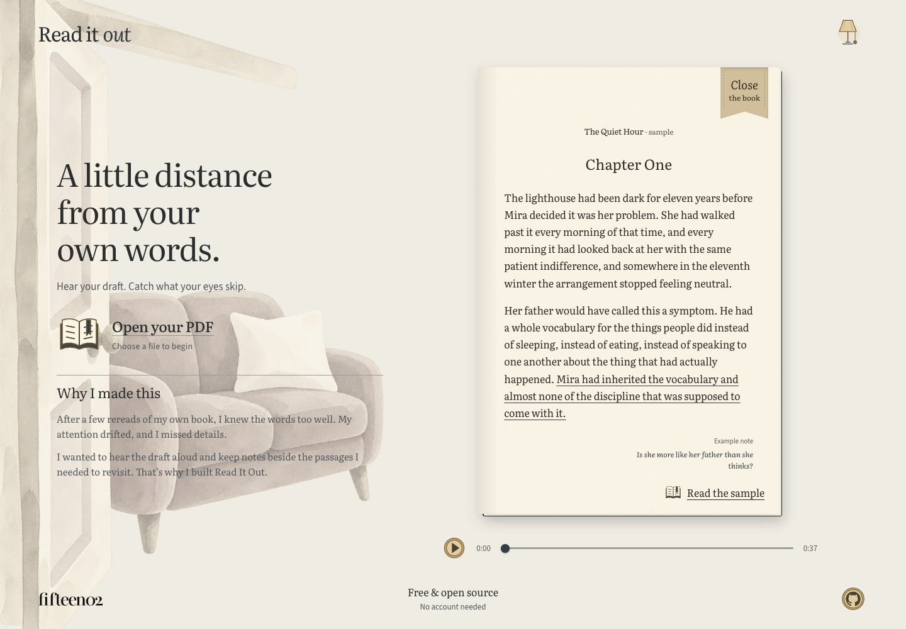
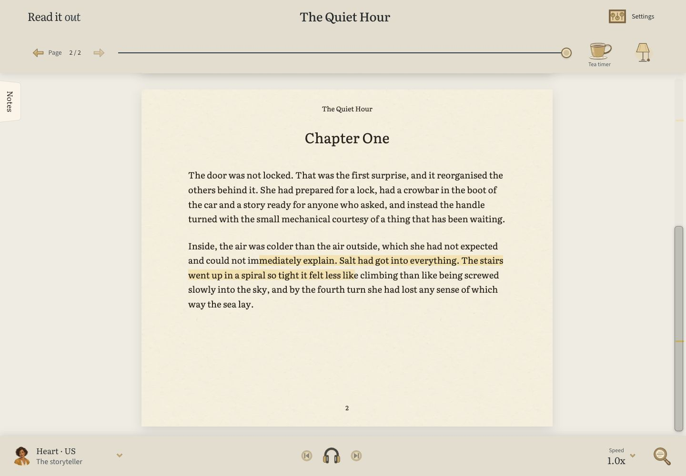
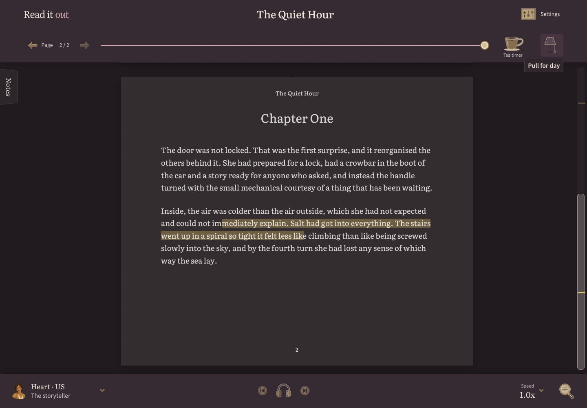

# Read It Out

**Hear your draft. Catch what your eyes skip.**

Read It Out is a PDF reader for listening, highlighting, and keeping notes beside
the passages you want to revisit. Speech runs on your device. No account required.

[**Open Read It Out →**](https://readitout.me) · [Run locally](#running-it-locally) · [Development guide](app/README.md)



## Read, listen, revise

- **Listen as you read.** Choose a voice and playback speed, follow the highlighted text,
  and move between passages without losing your place.
- **Keep feedback beside the words.** Highlight passages, add notes and tags, and export
  your review as Markdown, JSON, or a copyable review brief.
- **Find your way through a document.** Use its outline, page tracker, zoom controls,
  and reading markers.
- **Settle into a reading session.** Switch between day and night appearances, use the
  focus guide, or set a reading timer.

| Day reading | Night reading |
| --- | --- |
|  |  |

*Screenshots use The Quiet Hour, the included fictional sample. Open it from the welcome screen to try the reader.*

## Local reading

PDFs and annotations stay in your browser. Kokoro, the standard reading model, generates
speech on the device in a background worker. Model and voice files download from Hugging
Face once; document text is not sent there. Your browser caches those files when storage
permits. No account, API key, or speech server is needed.

**Analytics.** The hosted site at [readitout.me](https://readitout.me) records five
anonymous events through Google Analytics: `pdf_opened` (page count and file size in KB),
`pdf_open_failed`, `read_aloud_started` (which mode), `annotation_created` (whether it has
a note), and `voice_previewed` (which engine). No filenames, no document text, no page
content, no account, no identifier you gave us.

Self-hosted builds do not send analytics. The snippet in `app/index.html` is gated on the
`readitout.me` hostname, so a fork, a local run or an offline build never contacts Google —
and the self-hosted Content-Security-Policy doesn't allow it either. To strip it entirely,
delete that one `<script>` block.

## Try it without finding a document

The lobby plays a prerecorded Kokoro reading of a fictional manuscript, with measured
sentence highlighting. It works immediately without the model download. The optional
sample opens a reading copy with desktop or phone page proportions.

## Voices

**Kokoro is the standard model.** Choose an English voice such as Heart or Emma in the
reader. Download it through **Settings → Reading voice** (about 120–450 MB including runtime
files). It uses WebGPU when an adapter is available, with a CPU/WebAssembly fallback if GPU loading or generation fails. There is no cloud speech call.
Older devices may take longer to prepare each passage. Kokoro is the only speech engine;
readers choose a voice without selecting a model or provider.

## Running it locally

```bash
cd app
npm install
npm run dev          # front-end on :5273, static server on :4173
```

Build and serve the production bundle:

```bash
npm run build
npm start
```

See [`app/README.md`](app/README.md) for the full development guide, covering on-device voices, recording the lobby sample, type-checking and project layout. See
[`app/DEPLOY.md`](app/DEPLOY.md) for Firebase Hosting and Cloud Run deployment.

## Built with

TypeScript, Vite, and [pdf.js](https://mozilla.github.io/pdf.js/) (bundled, not CDN-loaded),
with a small typed Node server. No front-end framework.

---

Built by [fifteen02](https://fifteen02.com).
